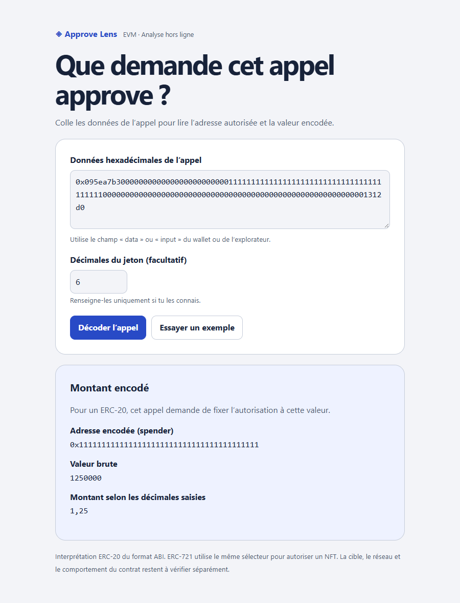

# Approve Lens

An offline browser tool that decodes the address and value in an EVM `approve(address,uint256)` call using the ERC-20 interpretation. No dependencies, account, wallet connection or network requests.

## Run locally

Open `index.html` in a modern browser. Select **Essayer un exemple** to decode a synthetic call with the value 1,250,000. With six decimals, the page displays **1,25**. For your own example, paste the call's **data** or **input** field and choose **Décoder l’appel**. The interface is in French.

## Chrome extension

Extract the Chrome release ZIP. Open `chrome://extensions`, enable **Developer mode**, select **Load unpacked**, and choose the folder containing `manifest.json`. The extension uses the same offline decoder and requests zero permissions.

## Scope

The app accepts exactly one canonical 68-byte call. It reports zero, a finite value, or the exact maximum uint256. Token decimals are optional and supplied by the user. Calculations use BigInt.

The selector is shared by ERC-721, where the same word represents a token ID. The app cannot infer the chain, identify the target contract, confirm the token standard, determine current allowances or predict execution. Permit, Permit2 and multicalls are outside scope. A token or UI may treat values other than the exact uint256 maximum as effectively unlimited.

[ERC-20](https://eips.ethereum.org/EIPS/eip-20) · [ERC-721](https://eips.ethereum.org/EIPS/eip-721) · [Solidity ABI](https://docs.soliditylang.org/en/latest/abi-spec.html)

## Tests

Run `node --test` from the repository root with Node.js 20 or later. The tests execute the decoder used by both the web app and Chrome popup.

## Publish

Suggested repository name is `approve-lens`. Push the files to `main`. In GitHub, open **Settings → Pages**, select **Deploy from a branch**, then choose **main** and **/(root)**. The included `.nojekyll` file enables direct static serving.

See [the research and shortlist](RESEARCH.fr.md). MIT licensed.
